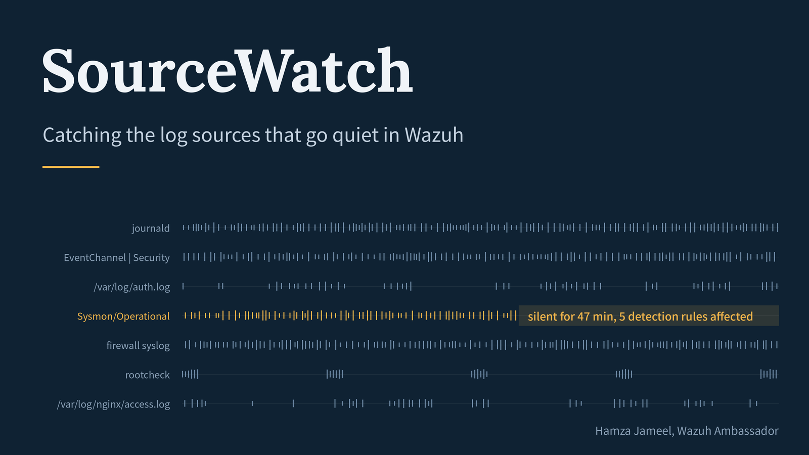
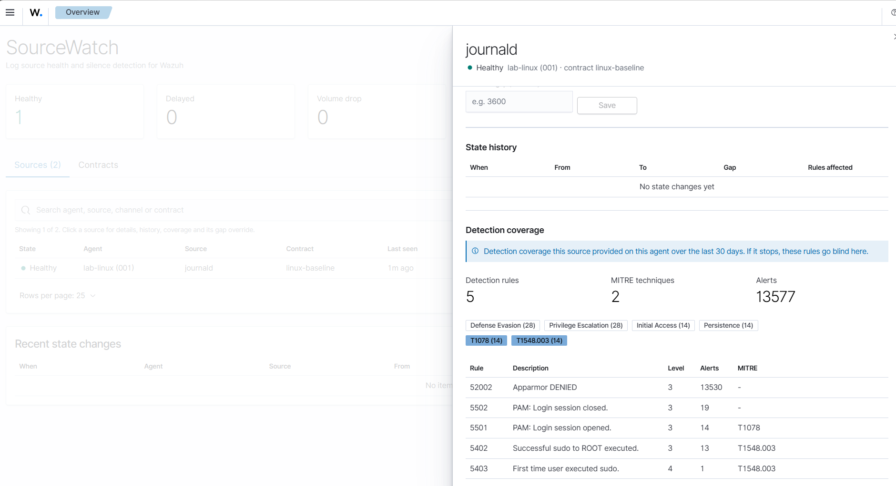
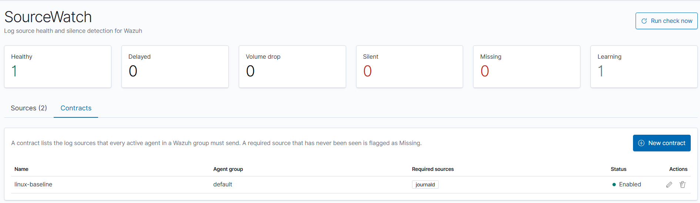

# SourceWatch

**Log source health and silence detection for Wazuh.**

Wazuh tells you whether an agent is connected. It does not tell you whether each log source on that agent is still sending events. When a Sysmon service stops, a firewall stops forwarding syslog, or a log file is rotated away, the result looks exactly like "no attacks": the detection rules that depended on that source simply go quiet.

SourceWatch is a Wazuh dashboard plugin that learns the normal rhythm of every log source, flags the ones that go quiet, shows which detection rules and MITRE techniques you lose when they do, and raises native Wazuh alerts so your SOC sees it like any other alert.

> **Disclaimer:** SourceWatch is an independent community project. It is not affiliated with, endorsed by, or supported by Wazuh, Inc. "Wazuh" is a trademark of Wazuh, Inc.



---

## Features

- **Automatic source discovery.** Every combination of agent, log location and Windows event channel that produces events is tracked. No configuration needed.
- **Adaptive baselines.** Each source learns its own normal gap between events. Busy, periodic and rare sources are each judged against their own rhythm, and outages are never learned as "normal".
- **Clear health states.**

  | State | Meaning |
  |---|---|
  | Learning | New source, still building its baseline |
  | Healthy | Reporting within its normal rhythm |
  | Delayed | Quiet for longer than usual |
  | Silent | Quiet far beyond its normal rhythm |
  | Volume drop | Still reporting, but far fewer events than normal |
  | Missing | Required by a contract but never seen |

- **Contracts.** Declare which sources every agent in a Wazuh group must send (for example, every domain controller must send Security, Sysmon and PowerShell logs). Required sources that never appear are flagged as Missing.
- **Detection coverage.** For each source, see the rules, MITRE techniques and tactics it fed over the last 30 days. That is exactly what goes blind if it stops. For a Missing source, coverage is shown from the same source on other agents.
- **Native Wazuh alerts.** State changes are sent to the Wazuh manager and matched by a bundled rule pack, so they appear in `wazuh-alerts-*` with MITRE mapping and can use your existing notifications and integrations.
- **Gap overrides.** Mark sources that legitimately sleep (such as weekly jobs) so they are not flagged too early.

---

## How it works

```
 Agents / syslog ──► Wazuh manager ──► Wazuh indexer (wazuh-alerts-*)
                          ▲                          │
                          │ POST /events             ▼
                          │               ┌─────────────────────────┐
     rules 100700-100706 ─┘               │  SourceWatch (dashboard) │
                                          │  discover → baseline →   │
                                          │  evaluate → coverage     │
                                          └────────────┬────────────┘
                                                       ▼
                                     sourcewatch-inventory / -state-* / -config
```

Every cycle (15 minutes by default), SourceWatch reads recent events from the indexer, updates each source's baseline, decides its state, and stores the result in its own indices. When a state changes, it attaches the affected detection coverage and sends an event to the Wazuh manager, where the bundled rules turn it into an alert.

---

## Compatibility

| Component | Version |
|---|---|
| Wazuh | 4.14.x (tested on 4.14.9) |
| Wazuh dashboard | Matching 4.14.x release. Plugin builds are tied to the exact dashboard version. |
| Wazuh server API | 4.6 or later (requires `POST /events`) |

### Tested in this release

- Linux agents (journald, log files, rootcheck), using `wazuh-alerts-*` as the source index
- Silence, delay, recovery and Missing detection, contracts, coverage and native alerts

### Not yet validated (roadmap)

- Windows event channels (Security, Sysmon, PowerShell). Supported by design, not yet tested.
- Using `wazuh-archives-*` as the source index
- Remote syslog sources
- Very large fleets (more than 10,000 sources)
- Wazuh 5.0

Feedback and test reports for these are very welcome.

---

## Installation

You need: shell access to the Wazuh dashboard host and the Wazuh manager, and an admin account for the Wazuh indexer.

### 1. Download the plugin

From the [Releases](../../releases) page, download the `sourcewatch-<version>.zip` built for your Wazuh dashboard version.

### 2. Install the plugin on the Wazuh dashboard

```bash
sudo -u wazuh-dashboard /usr/share/wazuh-dashboard/bin/opensearch-dashboards-plugin \
  install file:///path/to/sourcewatch-<version>.zip
```

For **wazuh-docker**, build a dashboard image with the plugin pre-installed using [`docker/Dockerfile`](docker/Dockerfile), and use that image for the `wazuh.dashboard` service.

### 3. Grant indexer permissions

The dashboard's server user (`kibanaserver` by default) runs the SourceWatch engine and needs access to the SourceWatch indices and read access to the alerts. Run against your Wazuh indexer:

```bash
INDEXER=https://<wazuh-indexer>:9200
ADMIN='admin:<admin-password>'

# Role for the background engine
curl -sk -u "$ADMIN" -X PUT "$INDEXER/_plugins/_security/api/roles/sourcewatch_service" \
  -H 'Content-Type: application/json' -d @security/sourcewatch_service_role.json
curl -sk -u "$ADMIN" -X PUT "$INDEXER/_plugins/_security/api/rolesmapping/sourcewatch_service" \
  -H 'Content-Type: application/json' -d '{"users": ["kibanaserver"]}'

# Role for dashboard users who are not administrators
curl -sk -u "$ADMIN" -X PUT "$INDEXER/_plugins/_security/api/roles/sourcewatch_user" \
  -H 'Content-Type: application/json' -d @security/sourcewatch_user_role.json
```

Map `sourcewatch_user` to the users or backend roles who should use SourceWatch. Users with `all_access` (such as `admin`) need nothing extra.

### 4. Install the rule pack on the Wazuh manager

```bash
sudo cp ruleset/sourcewatch_rules.xml /var/ossec/etc/rules/
sudo chown wazuh:wazuh /var/ossec/etc/rules/sourcewatch_rules.xml
sudo chmod 660 /var/ossec/etc/rules/sourcewatch_rules.xml
sudo systemctl restart wazuh-manager
```

In a Wazuh cluster, install it on the master node. The rule IDs used are **100700-100706**. Make sure they don't collide with your own custom rules.

### 5. Create a Wazuh API user

SourceWatch needs a Wazuh API user with `event:ingest` and `agent:read`. Follow [docs/wazuh-api-user.md](docs/wazuh-api-user.md) to create a dedicated one.

### 6. Configure the dashboard

Add the settings from [`config/opensearch_dashboards.sourcewatch.yml`](config/opensearch_dashboards.sourcewatch.yml) to `/etc/wazuh-dashboard/opensearch_dashboards.yml` (or `config/wazuh_dashboard/opensearch_dashboards.yml` in wazuh-docker). At minimum:

```yaml
sourcewatch.wazuhApi.enabled: true
sourcewatch.wazuhApi.url: "https://<wazuh-manager>:55000"
sourcewatch.wazuhApi.username: "sourcewatch"
sourcewatch.wazuhApi.password: "<api-password>"
```

### 7. Restart and verify

```bash
sudo systemctl restart wazuh-dashboard
sudo journalctl -u wazuh-dashboard -f | grep -i sourcewatch
```

You should see `SourceWatch started: ...` followed by `SourceWatch cycle: N sources, ...` lines. Open the dashboard menu and select **SourceWatch**.

New sources start in **Learning** and need the warm-up period (24 hours by default) before they can raise alerts. This avoids false alarms from scheduled jobs that only run once a day.

---

## Using SourceWatch

### Sources tab

The summary cards show how many sources are in each state. Click a card to filter the table. Use the search box and filters to find a source by agent, location, channel or contract.

Click any source to open its panel:

- **Details:** last seen, normal gap (p95), learned samples and normal volume.
- **Gap override:** set a minimum gap for sources that legitimately sleep. SourceWatch will not flag the source before that gap.
- **State history:** every state change for this source, with how many detection rules were affected.
- **Detection coverage:** the rules, MITRE techniques and tactics this source fed over the last 30 days.



### Contracts tab

A contract says: *every active agent in Wazuh group X must send these sources.* Pick discovered sources from the list, or type new ones as `location` or `location | channel`, for example:

- `journald`
- `/var/log/auth.log`
- `EventChannel | Security`
- `EventChannel | Microsoft-Windows-Sysmon/Operational`

Required sources that have never been seen on an agent appear as **Missing**. When they start reporting, they move to Learning and are tracked normally.



### Alerts

| Rule | Level | Fires when |
|---|---|---|
| 100700 | 0 | Any SourceWatch state change (parent rule) |
| 100701 | 8 | A source went **silent** (MITRE T1562) |
| 100702 | 5 | A source is **delayed** |
| 100703 | 6 | A source's event **volume dropped** |
| 100704 | 3 | A source **recovered** |
| 100705 | 7 | A required source is **missing** (MITRE T1562) |
| 100706 | 3 | A missing source **started reporting** |

All alerts belong to the `sourcewatch` rule group. Search for `rule.groups:sourcewatch` in the Wazuh dashboard. The alert data includes the agent, location, channel, contract, gap, and the number and MITRE IDs of affected detection rules (`data.sourcewatch.*`).


---

## Configuration reference

All settings go in `opensearch_dashboards.yml` and require a dashboard restart.

| Setting | Default | Description |
|---|---|---|
| `sourcewatch.enabled` | `true` | Turn the plugin's background engine on or off |
| `sourcewatch.sourceIndex` | `wazuh-alerts-*` | Index pattern scanned to discover sources |
| `sourcewatch.intervalSeconds` | `900` | How often the engine runs (minimum 30) |
| `sourcewatch.ingestLagSeconds` | `60` | Delay that allows for indexing lag |
| `sourcewatch.warmupSeconds` | `86400` | How long a new source only learns before it can alert |
| `sourcewatch.gapHistory` | `50` | Number of recent gaps kept per source |
| `sourcewatch.gapPercentile` | `0.95` | Percentile of recent gaps used as the normal gap |
| `sourcewatch.minGapSamples` | `5` | Gaps needed before a source can alert |
| `sourcewatch.volumeDropRatio` | `0.2` | Volume drop when a window has less than this share of normal |
| `sourcewatch.rebaselineAfterCycles` | `12` | Cycles after which a lower volume becomes the new normal |
| `sourcewatch.ignoreLocations` | `API-Webhook`, `wazuh-remoted`, `wazuh-agent`, `wazuh-monitord` | Event-driven locations that are never tracked |
| `sourcewatch.forgetAfterDays` | `30` | Remove sources not seen for this long (contract-required sources are kept) |
| `sourcewatch.alertsIndex` | `wazuh-alerts-*` | Where detection coverage is calculated from |
| `sourcewatch.coverageDays` | `30` | Coverage lookback window |
| `sourcewatch.wazuhApi.enabled` | `false` | Enable native alerts and contracts |
| `sourcewatch.wazuhApi.url` | `https://localhost:55000` | Wazuh server API URL |
| `sourcewatch.wazuhApi.username` | `wazuh-wui` | Wazuh API user |
| `sourcewatch.wazuhApi.password` | *(empty)* | Wazuh API password |
| `sourcewatch.wazuhApi.verifyTls` | `false` | Verify the Wazuh API certificate |

**Thresholds:** a source becomes Delayed after `max(2 × interval, 1.5 × normal gap)` without events, and Silent after `max(4 × interval, 3 × normal gap)`. A gap override raises the normal gap to at least the override value.

---

## Data stored

| Index | Contents |
|---|---|
| `sourcewatch-inventory` | Current state and baseline of every source |
| `sourcewatch-state-YYYY.MM` | History of state changes (one index per month) |
| `sourcewatch-config` | Contracts, gap overrides and the scheduler lock |

Add an index lifecycle policy for `sourcewatch-state-*` if you want to limit how long history is kept. In multi-node dashboard deployments, a shared lock ensures only one node runs the engine at a time.

---

## HTTP API

All endpoints are under `/api/sourcewatch` on the dashboard and use the logged-in user's permissions. Write requests need the `osd-xsrf: true` header.

| Method | Endpoint | Description |
|---|---|---|
| GET | `/sources` | All tracked sources |
| GET | `/summary` | Count of sources per state |
| GET | `/events` | Latest 50 state changes |
| POST | `/run` | Run a check now |
| GET | `/sources/{id}/history` | State history of one source |
| GET | `/sources/{id}/coverage` | Detection coverage of one source |
| PUT | `/sources/{id}/settings` | Set or clear a gap override: `{"min_gap_seconds": 3600}` or `null` |
| GET | `/contracts` | List contracts |
| PUT | `/contracts/{name}` | Create or update a contract |
| DELETE | `/contracts/{name}` | Delete a contract |

Example contract:

```bash
curl -s -u <user>:<password> -X PUT -H 'osd-xsrf: true' -H 'Content-Type: application/json' \
  https://<dashboard>/api/sourcewatch/contracts/windows-dc-baseline \
  -d '{"group":"domain-controllers","required":[
        {"location":"EventChannel","channel":"Security"},
        {"location":"EventChannel","channel":"Microsoft-Windows-Sysmon/Operational"}]}'
```

---

## Troubleshooting

| Symptom | Check |
|---|---|
| No sources appear | Confirm agents are generating alerts in `sourcewatch.sourceIndex`, and check the dashboard log for `SourceWatch cycle` lines |
| `security_exception` in the dashboard log | The indexer role from step 3 is missing or not mapped to `kibanaserver` |
| No SourceWatch alerts | Check `sourcewatch.wazuhApi.*`, the API user's permissions, and that the rule pack is loaded |
| "Contracts need sourcewatch.wazuhApi.enabled" in the log | Contracts need the Wazuh API to look up agent groups |
| Everything stays in Learning | Expected during the warm-up period (24 hours by default) |

---

## Uninstall

```bash
sudo -u wazuh-dashboard /usr/share/wazuh-dashboard/bin/opensearch-dashboards-plugin remove sourcewatch
sudo rm /var/ossec/etc/rules/sourcewatch_rules.xml && sudo systemctl restart wazuh-manager
```

Remove the `sourcewatch.*` lines from `opensearch_dashboards.yml` and restart the dashboard. Optionally delete the `sourcewatch-*` indices and the `sourcewatch` index template.

---

## Building from source

Place the `sourcewatch` folder in the `plugins/` directory of a [wazuh-dashboard](https://github.com/wazuh/wazuh-dashboard) checkout matching your target version, bootstrap it, then run `yarn build --opensearch-dashboards-version <version>` inside `plugins/sourcewatch`.

---

## Contributing

Issues, test reports (especially Windows, archives and large deployments) and pull requests are welcome.

## License

Apache License 2.0. See [LICENSE](LICENSE).

## Author

Hamza Jameel ([@DShamzaj](https://github.com/DShamzaj)), Wazuh Ambassador, Pakistan.

*SourceWatch is an independent community project and is not affiliated with Wazuh, Inc.*
